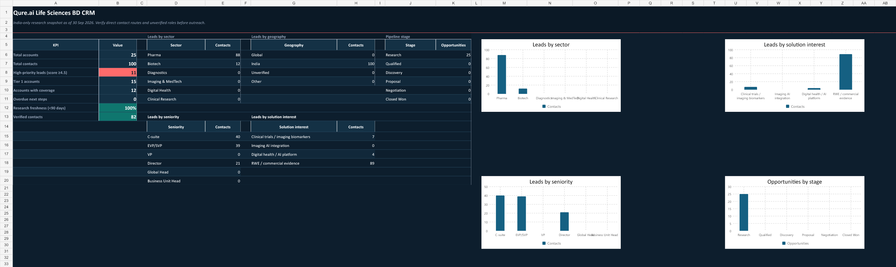

# Qure.ai India Life Sciences CRM

[**LINK**](https://docs.google.com/spreadsheets/d/1F2nD-3QoUCU-X8zN2wNUlRHUWAWjGFtHRqdxwArpNxI/edit?usp=sharing)

Evidence-first CRM workspace for Qure.ai's India Life Sciences Business Development team.

## Primary deliverables

- `outputs/qure-life-sciences-crm-qure-styled/qure_india_life_sciences_crm_qure_styled.xlsx` - Qure-branded Excel CRM with accounts, contacts, opportunities, activities, research sources, controls, formulas, and dashboard.
- `output/pdf/qure_crm_full_scale_vertical_onboarding_poster.pdf` - full-scale vertical onboarding poster with detailed CRM screenshots and operating guidance.
- `output/pdf/qure_crm_single_page_operating_poster.pdf` - compact A3 operating-poster variant.
- `outputs/qure-crm-onboarding-field-guide/qure_crm_india_field_guide.pdf` - eight-page field guide.

## Open the CRM onboarding material

- [Open the full-scale vertical CRM onboarding poster (PDF)](output/pdf/qure_crm_full_scale_vertical_onboarding_poster.pdf)
- [Open the CRM field guide (PDF)](outputs/qure-crm-onboarding-field-guide/qure_crm_india_field_guide.pdf)
- [Download the Qure-branded India Life Sciences CRM workbook](https://docs.google.com/spreadsheets/d/1F2nD-3QoUCU-X8zN2wNUlRHUWAWjGFtHRqdxwArpNxI/edit?usp=sharing)

The CRM research uses public professional information only. Unverified data is explicitly marked and must not be used as outreach-ready contact data.

## Rebuild artifacts

Use the supplied scripts to reproduce the workbook and posters. The output PDFs are generated with ReportLab; Excel workbooks are generated with the bundled spreadsheet runtime.
